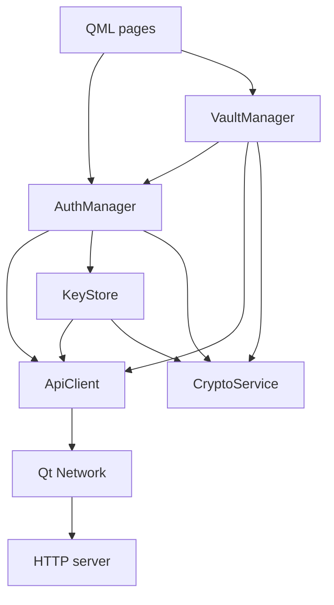

# Passwall Desktop Architecture

## Overview

The desktop application separates QML presentation, application state, HTTP
communication and cryptography. Its implementation follows the current
[OpenAPI contract](../../api/openapi.yaml), including the absence of a vault-key
retrieval endpoint. Setup instructions are in [README](README.md).

## Structure

```text
apps/desktop/
  CMakeLists.txt
  README.md
  ARCHITECTURE.md
  src/
    main.cpp
    api/
      ApiClient.{h,cpp}
      dto/ApiTypes.h
    auth/
      AuthManager.{h,cpp}
      KeyStore.{h,cpp}
    crypto/
      CryptoService.{h,cpp}
    vault/
      VaultManager.{h,cpp}
      VaultEntry.h
    qml/
      Main.qml
      LoginPage.qml
      RegisterPage.qml
      VaultPage.qml
  tests/
    ClientTests.cpp
```

## Components

| Component | Responsibility |
| --- | --- |
| `main.cpp` | Constructs dependencies, exposes managers to QML and loads the application. |
| QML pages | Input, navigation, state display, explicit password reveal and delete confirmation. |
| `AuthManager` | Registration, login/logout, session state and encrypted-key backup/import. |
| `VaultManager` | Unlock/lock, decrypted entry state, refresh/create/delete and stale-result rejection. |
| `ApiClient` | Typed operations, DTO serialization, HTTP requests, Bearer headers and response validation. |
| `KeyStore` | Account/server-scoped encrypted metadata, atomic writes and backup identity checks. |
| `CryptoService` | Argon2id derivation, random keys/nonces, authenticated encryption and decryption. |
| `SecretKey` | Owns a non-copyable key buffer and wipes it on destruction. |

`VaultEntry` represents decrypted application data; `VaultEntryDto` represents
encrypted API data. List summaries omit passwords. Password reveal is an explicit
manager call. DTO definitions contain no network or QML behavior.

## Dependencies



`KeyStore` reuses the API's key-metadata serializer and parser; it does not send
HTTP requests. `CryptoService` uses DTO value types, Qt Core and libsodium,
without depending on network or QML objects. QML never constructs HTTP payloads
or handles vault keys.

CMake targets are `passwall_desktop_api`, `passwall_desktop_crypto`,
`passwall_desktop_auth`, `passwall_desktop_vault` and `passwall_desktop`.

## Flows

### Registration

1. QML passes email, authentication password and master password to `AuthManager`.
2. A worker task generates a vault key, derives the key-encryption key and wraps
   the vault key. The plaintext master password stays on the client.
3. `KeyStore` durably stages an encrypted candidate before the HTTP request.
4. `ApiClient` sends the authentication password, KDF parameters and wrapped key.
5. On confirmed success, local metadata is saved and the pending candidate removed.
   If confirmation or storage fails, recovery data remains available.

### Login and unlock

1. Login returns a Bearer token held in memory by `ApiClient`.
2. Authentication does not unlock the vault.
3. `VaultManager` obtains encrypted metadata from local storage or the current
   registration recovery state. Imported backups must match server URL and email.
4. A worker validates KDF bounds, derives the wrapping key and decrypts the vault key.
5. Successful unlock triggers an encrypted-entry fetch and local decryption.

There is no `getVaultKeyInfo()` network operation. Accounts opened on a new device
need a compatible encrypted-key backup. The architecture does not assume an
endpoint absent from OpenAPI.

### Vault operations and logout

- Create serializes entry data and encrypts it before calling `ApiClient`.
- Refresh decrypts and validates all returned entries before replacing list state.
- Delete sends the selected entry ID; the server enforces ownership.
- Lock drops the key, clears entries and invalidates pending vault results.
- Logout locks immediately and requests server revocation. Local authentication
  is cleared when the request finishes, even if remote revocation fails.

## State and concurrency

`AuthManager` owns authentication state; `VaultManager` owns unlocked state.
Both expose busy/error state and signals to QML. Qt Concurrent runs expensive
KDF work outside the UI thread. Network operations are asynchronous.

Generation counters reject stale responses after session changes or locking.
Callbacks use guarded QObject pointers; background tasks capture value data.
Application shutdown clears active state and waits for outstanding worker tasks.

## Security and limits

- Separate authentication and master passwords serve different purposes.
- Key derivation defaults to Argon2id, 64 MiB, three passes and parallelism one.
  Imported metadata is limited to 8-256 MiB, 1-10 passes and parallelism one.
- XChaCha20-Poly1305 uses independent random nonces and distinct associated data
  for wrapped vault keys and entries.
- Tokens and decrypted entries are memory-only. Persistent metadata and backups
  contain wrapped keys, KDF parameters, nonces and account identity.
- Requests time out after 15 seconds; responses are limited to 4 MiB.
- Remote servers require HTTPS. Certificate verification is enabled and redirects
  are not followed.
- Qt/QML string copies prevent a guarantee that every plaintext copy is wiped.

## Conventions

Both applications use C++23, PascalCase type/file names, lowerCamelCase functions
and trailing underscores for private data members. Python tests use snake_case.
C++ namespaces and CMake targets are scoped by application: `passwall::desktop`
and `passwall_desktop_*` here, `passwall::server` and `passwall_server_*` on the server.

Formatting is defined by [clang-format](../.clang-format) and
[EditorConfig](../.editorconfig): UTF-8, LF, four-space code indentation and
Allman C++ braces. Markdown uses one H1 title, sentence-case H2/H3 headings,
fenced code blocks, relative links and blank lines around lists.

## Related documentation

- [Desktop setup](README.md)
- [Server architecture](../server/ARCHITECTURE.md)
- [OpenAPI contract](../../api/openapi.yaml)
