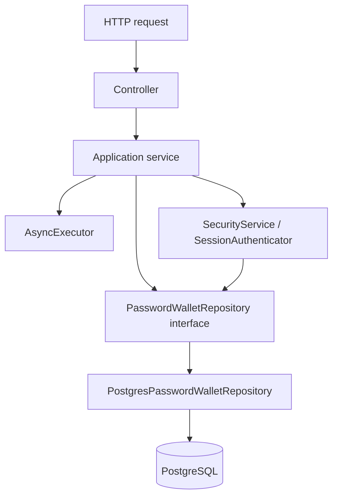

# Passwall Server Architecture

## Overview

The server has three layers: HTTP controllers, application services and a
PostgreSQL repository. It authenticates users and stores client-encrypted data;
it never needs a master password or plaintext vault key. Setup instructions are
in [README](README.md).

## Structure

```text
apps/server/
  CMakeLists.txt
  README.md
  ARCHITECTURE.md
  src/
    main.cpp
    controllers/
      HealthController.{h,cpp}
      AuthenticationController.{h,cpp}
      VaultController.{h,cpp}
      HttpSupport.{h,cpp}
    services/
      HealthService.{h,cpp}
      AuthenticationService.{h,cpp}
      VaultService.{h,cpp}
      ServiceTypes.h
      AsyncExecutor.{h,cpp}
      security/
        SecurityService.{h,cpp}
        SessionAuthenticator.{h,cpp}
      repositories/
        PasswordWalletRepository.h
        PostgresPasswordWalletRepository.{h,cpp}
        schema.sql
  tests/
    test_integration.py
```

The data-access layer is physically under `services/repositories`, but remains
a separate dependency boundary and CMake target.

## Components

| Component | Responsibility |
| --- | --- |
| `main.cpp` | Constructs the concrete repository, services and controllers; starts Drogon. |
| Controllers | Map OpenAPI routes, validate HTTP input and serialize service results. |
| `HttpSupport` | Shared JSON validation, Bearer extraction and HTTP response helpers. |
| `HealthService` | Repository connectivity and schema readiness. |
| `AuthenticationService` | Registration, password verification, session creation and logout. |
| `VaultService` | Authenticated list/create/delete operations and entry-ID validation. |
| `SecurityService` | Password hashes, UUID generation, JWT signing and verification. |
| `SessionAuthenticator` | Combines JWT checks with persisted session checks. |
| `AsyncExecutor` | Runs blocking database and password-hashing work outside HTTP event loops. |
| `PasswordWalletRepository` | Thread-safe, synchronous persistence interface. |
| `PostgresPasswordWalletRepository` | Parameterized SQL and row-to-value mapping. |

## Dependencies



Controllers do not execute SQL or perform cryptography. Services contain no
Drogon HTTP/ORM code and depend on the repository interface. The concrete
repository does not select HTTP status codes, parse JWTs or hash passwords.
`main.cpp` selects and injects the PostgreSQL adapter.

CMake targets are `passwall_server_contracts`, `passwall_server_repositories`,
`passwall_server_services`, `passwall_server_controllers` and `passwall_server`.
The service target does not link the concrete repository. Contract types retain
JsonCpp for opaque client KDF metadata.

## Flows

### HTTP routing

| OpenAPI tag | Controller and service | Routes |
| --- | --- | --- |
| Health | `HealthController`, `HealthService` | `GET /health`, `GET /ready` |
| Authentication | `AuthenticationController`, `AuthenticationService` | `POST /register`, `POST /login`, `POST /logout` |
| Vault | `VaultController`, `VaultService` | `GET /vault/entries`, `POST /vault/entries`, `DELETE /vault/entries/{id}` |

`/health` checks process liveness without using the database. `/ready` resolves
the required schema through the repository and returns 503 on failure.

### Authentication

1. Registration validates input, hashes the authentication password and inserts
   the user with KDF metadata and the client-wrapped vault key.
2. Database uniqueness makes concurrent duplicate registrations return conflict.
3. Login verifies the stored hash, signs a JWT and persists its session before
   returning the token. Unknown users still perform a dummy hash verification.
4. Protected operations verify JWT claims and require a matching unexpired session.
5. Logout deletes that session; subsequent uses of the token fail authentication.

### Vault operations

The service derives the owner from the verified session. Repository queries
scope reads and deletes by user ID; creates receive that same owner ID.
Missing, foreign and malformed entry IDs produce 404 after authentication.
Encrypted data is opaque to the server. It neither encrypts nor decrypts entries.

## State and concurrency

PostgreSQL stores three tables:

| Table | Stored state |
| --- | --- |
| `users` | UUID, unique email, password hash, client KDF metadata, wrapped vault key and nonce. |
| `auth_sessions` | Session UUID, owner UUID and expiration timestamp. |
| `vault_entries` | Entry UUID, owner UUID, ciphertext, nonce and UTC timestamps. |

The server uses two HTTP threads, four database connections and a shared executor
with two workers and a queue of up to 128 jobs. Database calls time out after five
seconds. Captured dependencies remain alive until tasks finish; shutdown drains
the executor. Repository failures become sanitized service errors.

## Security and limits

- Authentication passwords use Argon2id with random salts, three passes and 64 MiB.
  These parameters are independent of the client's vault KDF metadata.
- JWTs use HS256 and require issuer, audience, issue time, expiration, subject and
  session ID. Defaults are a 15-minute lifetime and a configured random secret.
- Ownership checks are applied in SQL using bound parameters.
- HTTP bodies are limited to 1 MiB. TLS termination and rate limiting are deployment
  responsibilities. Email uniqueness is case-sensitive.
- Requests authorized before concurrent logout may still finish. Expired sessions
  require periodic database cleanup.
- `GET /vault/key-info` is absent from OpenAPI and not implemented. The desktop
  currently relies on local encrypted metadata and backup/import.
- Backend failures return JSON 500 responses, even where the current specification
  does not explicitly list that fallback.

## Conventions

Both applications use C++23, PascalCase type/file names, lowerCamelCase functions
and trailing underscores for private data members. Python tests use snake_case.
C++ namespaces and CMake targets are scoped by application: `passwall::server`
and `passwall_server_*` here, `passwall::desktop` and `passwall_desktop_*` on the desktop.

Formatting is defined by [clang-format](../.clang-format) and
[EditorConfig](../.editorconfig): UTF-8, LF, four-space code indentation and
Allman C++ braces. Markdown uses one H1 title, sentence-case H2/H3 headings,
fenced code blocks, relative links and blank lines around lists.

## Related documentation

- [Server setup](README.md)
- [Desktop architecture](../desktop/ARCHITECTURE.md)
- [OpenAPI contract](../../api/openapi.yaml)
